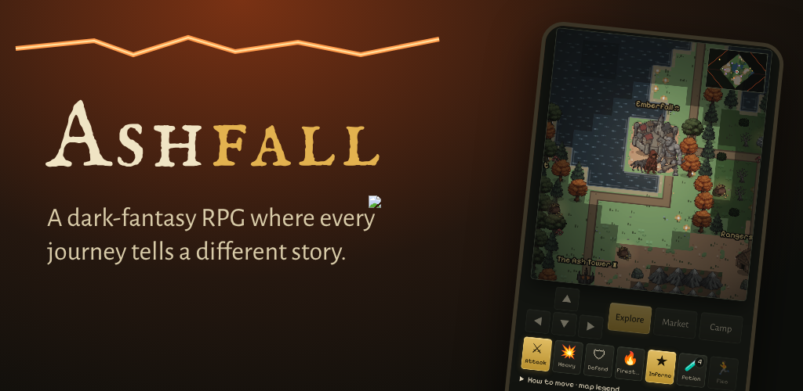

# Ashfall

A dark-fantasy pixel RPG where the story keeps writing itself as you walk.

**▶ Play it in your browser:** https://newnyansan.github.io/Ashfall/

On a phone, open the link and choose **Add to Home screen** / **Install app**: it then runs full-screen and offline like a normal app.

## What's inside
- A main story plus 15+ more story arcs, each chapter with a witness, a herald and a boss
- Five lands to uncover: the Ashlands, the Drowned Coast, the Frostmarch, the Glass Sea and the Cinder Reach
- Seven classes, nine weapons, runes, crafting, companions with bonds, mounts and pets
- Your own village to rebuild and defend, fishing and cooking, world bosses, the endless Ash Tower
- Seasonal events, daily goals, achievements, a Codex of lore books, New Game+
- English and Ελληνικά

Free, with no ads, no energy timers and no pay-to-win.

## Files
- `index.html` the whole game
- `sw.js`, `manifest.webmanifest` make it installable and playable offline
- `docs/` publishing notes and the Play Store listing draft

## Credits
Pixel art and sound effects: [Kenney](https://kenney.nl) (CC0). Painted scenes made with OpenArt AI. Engine: [Phaser](https://phaser.io). Fonts: IM Fell English SC, Alegreya Sans, Pixelify Sans (SIL Open Font License).
